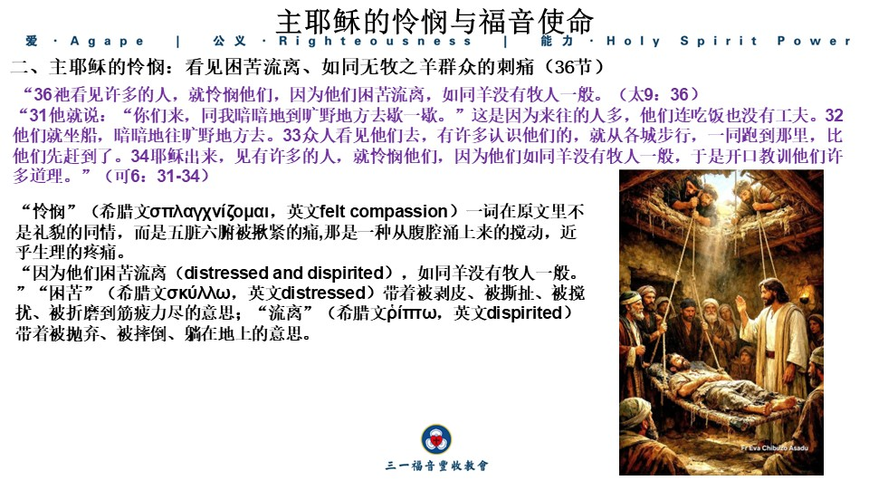
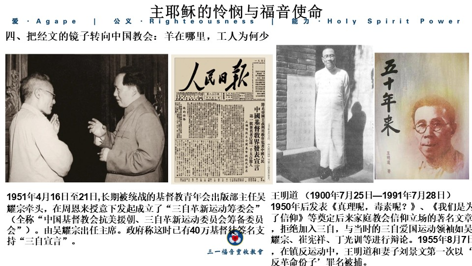
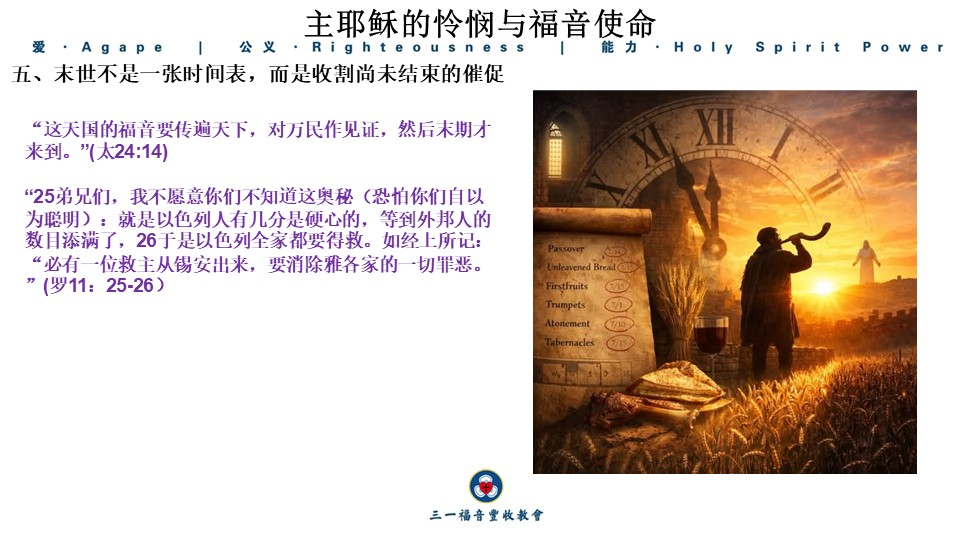
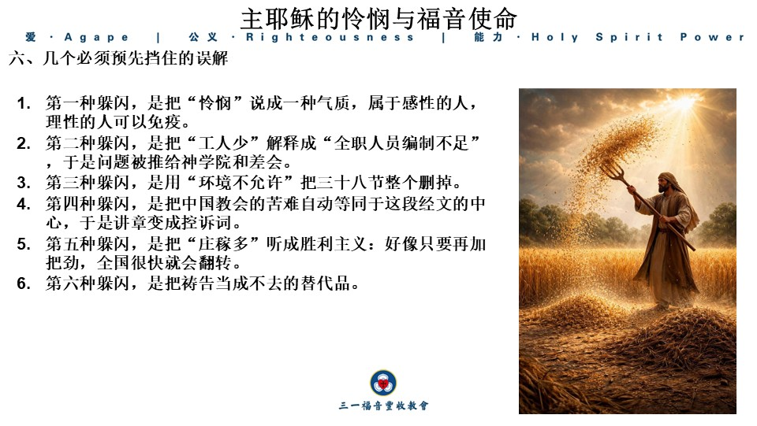
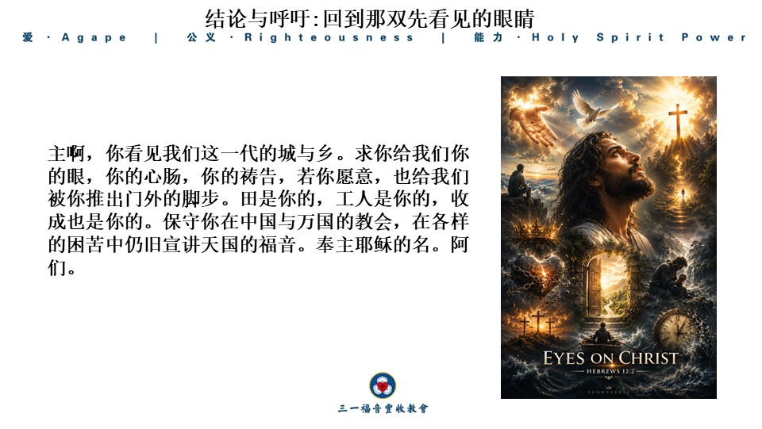

经文：

**“35****耶稣走遍各城各乡，在会堂里教训人，宣讲天国的福音，又医治各样的病症。****36****祂看见许多的人，就怜悯他们，因为他们困苦流离，如同羊没有牧人一般。****37****于是对门徒说：“要收的庄稼多，做工的人少；****38****所以，你们当求庄稼的主，打发工人出去收他的庄稼。”****”****（太****9****：****35-38****）**

 

前言：站在两段经文与两个世界之间

弟兄姐妹们，如果有人问你，哪一句简短的描述最能总结主耶稣在地上的公共事工？许多人会说是马太福音4:23，但也包括我们今天读到的这节经文（马太福音9:35）。两者几乎相同。马太并不是因为词穷而重复，而是运用了文学技巧告诉我们，从加利利开始到差遣十二使徒的前夕，主的工作性质没有改变。他教导、传讲天国的福音并医治。改变的是范围和深度。他“走遍”所有的城镇和村庄。他的脚步比我们的计划走得更远；他的眼睛比我们的统计更准确；他的心在我们的策略之前就已经破碎。 

约翰·斯托特，20世纪全球福音派领袖（1972年第一届洛桑世界福音大会的主讲人）和圣公会牧师，常说传道人必须进行“双重聆听”：一只耳朵听圣经，一只耳朵听当代世界，以便在两段时空之间架起桥梁：上帝已经说过的话今天仍然可以被听到和遵行。今天我们正在这样做。一边是尘土、会堂、病人和没有牧人的羊群的第一世纪加利利；另一边是21世纪的中国教会——登记的教会和未登记的聚会；公共讲坛和压缩在客厅和办公室隔间中的敬拜；一些地方仍在增长，另一些地方被拆除、监控九和判刑。我们不能将经文变成灵修片段或事件变成取代经文的讲道框架。经文必须作主，世界必须被经文照亮。

马太福音第5到7章是登山宝训，第8和9章是耶稣下山后与门徒一起所做的事（两章就像电影场景一个接一个——权柄的故事接连不断：麻风病人得洁净，百夫长的仆人得医治，热病退去，风暴平息，被鬼附的人得释放，瘫子罪得赦免并能再次行走，税吏被召，患血漏的妇女触摸主的衣裳，犹太会堂领袖的女儿从睡梦中醒来，两个盲人的眼睛得以打开）。马太这样做并不是为了让读者为他鼓掌，而是为了问“这样一个有权柄的人心中有什么？”他在第9章末尾给了我们答案。他不是某个神秘的行神迹者；他是一个牧人，当看到他的羊群时心碎。紧接着在第10章，破碎的心变成了差遣。因此，这段经文是一个枢纽：总结了主所做的事情，并开启了门徒要做的事情。如果我们仅仅将其视为“鼓励更多祷告的简短劝勉”，那么我们就低估了它在整本书中的分量。 

这段经文有一个主要思想，我想把它看作是一句可以带回家的话：主耶稣看见失丧之人的困苦，就动了最深的怜悯；这怜悯不是只停留在情感上，而是促使门徒向庄稼的主祈求，预备自己被打发进入已经成熟的禾场。

这句话包含了三件事，也是今天信息的三大支柱。首先，第35节告诉我们主是如何工作的；其次，第36节告诉我们主看到了什么，感受到了什么；第三，第37到38节告诉我们主因此要求门徒做什么。一旦支柱建立，我们就转向现在中国教会的状态和末世未完成的宣教使命。今天对这段经文的应用可能会感到沉重，不是因为我们试图批评任何人，而是因为主首先被群众的状况压垮。如果怜悯是真实的，它就不能是轻松的。

**一、主的事工是走出来的：教训、宣讲与医治同在一条路上（****35节）**

主的事工是行走出来的：教导、传道和医治都在同一条道路上（第35节）。“耶稣走遍各城各乡。”希腊文的现在时态并不意味着一次旅行，而是一个巡回。加利利并不大（城镇较小，村庄更小），但人口稠密，犹太会堂众多。历史学家约瑟夫（主耶稣之后的一代）记载加利利有204个城市和村庄。每个地方至少有一万五千人居住。即使只包括有城墙的城市（不包括村庄），这个估计也是保守的（并不是约瑟夫提到的所有城市和村庄都包括在内），即使那里的总人口少于三百万（约瑟夫估计为三百万），这个估计仍显示出人口的庞大。如果主每天在两个城市或村庄传道两次，那需要四个月才能覆盖这个地区。主没有等待一个理想的平台建成，也没有召开战略会议来决定哪些城镇“值得去”。他去了人们已经聚集的地方。犹太会堂是听摩西（公开辩论、教导和经文阅读）的地方；主“在那里教导人”——打开旧约指向自己；他“传讲天国的福音”，不是一套新的宗教产品，而是宣告：神的统治已经进入尘世，悔改之门已开，宽恕已来。他也“医治各样的病症”，不是将福音简化为医疗项目，而是以权柄证明这个国度不仅仅谈论来世，还触及被罪、恶魔和疾病撕裂的现世。

请注意马太将这三件事放在同一节经文中，但它们不是三个平等且可互换的活动。教导和传道是天国信息的核心；医治是怜悯的确认和外溢。主从未出售“只关心灵魂而忽视创伤的冷漠正统”，也没有将奇迹变成吸引人气的技巧，以便人们不必面对罪和悔改。他的道成肉身本身就是最好的注释：神的话进入人类的邻里，神的能力进入人类的痛苦，神的国度进入人类的日常生活。

这是今天教会的第一面镜子。我们很容易将事工分成部门：讲台属于讲台，关怀属于关怀，福音属于短期宣教队，医疗和探访成为可选的附加项目。但主的脚步将它们都放在同一条尘土路上。另一边的危险同样真实：在社会压力或文化安抚下，教会可能将“医治各样的病症”解释为仅仅是慈善、心理咨询和社区服务，而讲台逐渐不敢讲罪、十字架、复活和审判。这不是跟随主；这是留下主的一件衣服，取走主的心。

还有一个容易被遗忘的点：“各城各乡。”主的视野不仅在耶路撒冷的宗教中心，也不仅在熟悉的寻求者圈子。城市有骄傲和资源；村庄有遗忘。今天的“城市”是办公室大楼、大学城和一线城市的工业园区；今天的“村庄”是空心化的县城、工厂宿舍、照顾孩子的老人以及那些从乡村被抛入城市但不属于任何会众的人。如果我们的事工地图只覆盖熟悉的阶层，我们还没有“走遍各地”。

主走遍是因为那里有人。不是因为那里安全，也不是因为在那里容易取得成果。在马太福音中，加利利既是光明之地，也是“坐在死荫之地的人们”。主决定从边缘的北方土地开始，这已经是宣教神学：福音首先到达被轻视的地方。如果中国教会只将自己描绘成受害的少数群体，却拒绝走向更边缘化的人群（少数民族、残疾人、精神病患者、囚犯家庭、对信仰敌对的邻居），我们只是在自己的痛苦中打转，还没有学会主的脚步。

**二、主耶稣的怜悯：看见困苦流离、如同无牧之羊群众的刺痛（****36节）**

越来越多的人来到主耶稣面前——他们想听祂的话语，想见祂的面。服侍他们不仅需要体力，还需要情感上的消耗。有一次，祂想离开人群，乘船渡湖，以便避开他们（至少部分原因是因为这些压力）。但人群跑到湖的北岸，越过浅滩，在祂上岸时遇见了祂（马可福音6:31-34）。无论主耶稣暂时退避的尝试是否成功，祂肯定知道我们需要休息。

**“****31祂就说：“你们来，同我暗暗地到旷野地方去歇一歇。”这是因为来往的人多，他们连吃饭也没有工夫。32他们就坐船，暗暗地往旷野地方去。33众人看见他们去，有许多认识他们的，就从各城步行，一同跑到那里，比他们先赶到了。34耶稣出来，见有许多的人，就怜悯他们，因为他们如同羊没有牧人一般，于是开口教训他们许多道理。”（可6：31-34）****。**

但主耶稣对那些诚心寻求祂的人态度是怜悯。在总结主耶稣所有的辛劳后，马太说：**“****36****祂看见许多的人，就怜悯他们，”（太****9****：****36****）**第36节是整段经文的核心。在圣经中，“看见”不仅仅是眼球的动作。先知“看见”异象；牧人“看顾”羊群；主“看见”群众。祂所看见的不是群众对事工的益处（不是“今天的出席人数很棒”），而是一群人在属灵上的惨状。

“怜悯”这个词（希腊文σπλαγχνίζομαι，英文felt compassion）在原文中不是礼貌的同情，而是痛苦——一种从腹部升起的痛苦（身体的痛苦）。四福音书多次使用这个词来描述主：看见饥饿的人；两个盲人呼喊；寡妇唯一的儿子被抬出城。主不是某个训练表情的宗教专业人士；祂被感动。如果我们说神是爱，但把爱变成一个冷冰冰的教条条款，我们就误解了这节经文。当然，神的怜悯不是不受控制的情感——它有目的、有行动和真理。但没有温暖是不正确的。冷漠的正统和空洞的热情都不是耶稣在这里的情感。

怜悯的原因写得很具体**：****“****因为他们困苦流离（****distressed and dispirited****），如同羊没有牧人一般。**”“困苦”（希腊文σκύλλω，英文distressed）带着被剥皮、被撕扯、被搅扰、被折磨到筋疲力尽的意思；“流离”（希腊文ῥίπτω，英文dispirited）带着被抛弃、被摔倒、躺在地上的意思。这不是对贫穷的浪漫描写，而是对失牧状态的诊断。描绘的是被错误领袖剥削、被律法重担压垮、被黑暗权势搅扰、灵里无家可归的人群。旧约一再使用“羊没有牧人”这幅画。摩西求神给以色列立一个人，免得会众如羊没有牧人（民27：15-17）。米该雅看见以色列众民散在山上，如同没有牧人的羊（王上22：17）；以西结三十四章更是一篇对失职牧人的公诉状：肥己的吃羊，弱小的不扶，病的不治，失丧的不寻。神因此说：我必亲自作他们的牧者，也要设立我的仆人大卫来牧养他们（结34：23-24，31）。没有牧人，羊就被吞吃、被分散。主耶稣站在加利利的人群前看见的，正是神子民和万民最深的光景——不是缺宗教活动，而是缺真正的牧者。当时的文士与法利赛人并非没有宗教活动，他们的问题是把重担捆起来搁在人肩上，自己连一根指头也不肯动。有宗教，不等于有牧人。有会堂，不等于羊被喂养。有规矩，不等于人被寻回。

**“****15****摩西对耶和华说：****16“****愿耶和华万人之灵的　神，立一个人治理会众，****17****可以在他们面前出入，也可以引导他们，免得耶和华的会众如同没有牧人的羊群一般。****”****（民****27****：****15-17****）**

**“****米该雅说：****“****我看见以色列众民散在山上，如同没有牧人的羊群一般。耶和华说：****‘****这民没有主人，他们可以平平安安地各归各家去。****’”****（王上****22:17****）**

**“****23****我必立一牧人照管他们，牧养他们，就是我的仆人大卫。他必牧养他们，作他们的牧人。****24****我耶和华必作他们的　神，我的仆人大卫必在他们中间作王。这是耶和华说的。****……31****你们作我的羊，我草场上的羊乃是以色列人；我也是你们的　神。这是主耶和华说的。****’”(****结****34****：****23-24****，****31)**

这节经文让我们重新学习“看见”。今天最常见的盲目不是无神论者的盲目，而是信徒的功能性盲目：我们看到政策、风险、数字的起伏、我们自己会众的预算，却看不到人。有人在你旁边加班到深夜，灵魂干涸，你看到“他很忙，不方便说话”；一个年轻人把焦虑变成短视频中的笑话，你看到“不同的世代”；家庭教会的成员突然不再出现，你看到“他可能害怕”，但很少走进他的恐惧。主先看见，然后怜悯；我们常常先评估，然后决定是否看见。

把这个画面转向中国并不需要太多夸张。登记在政府认可的三自系统中的信徒是一群人；在未注册的家庭教会聚会的信徒是另一群人；从未听过清晰福音的数亿人仍然是更大的一群。在过去四十年中，许多城市的物质生活有所改善，但灵魂的困苦并没有随之减少。家庭破裂、教育压力、老年孤独、意义的真空和对他人的普遍不信任不是“仅在西方的现代疾病”——它们已经写在我们邻居的脸上。再加上信仰群体本身的漂泊：聚会场所关闭后，羊被赶进更小的房间；牧人被带走，一些团体解散；未成年人被禁止进入，信仰在家庭中的传递变成耳语。更隐蔽的漂泊是从讲台上的扭曲——当信息必须先通过一层意识形态过滤时，羊听到的是扭曲的圣经和话语。并不是每个登记的三自教会都是这样，也不是每个家庭聚会都是纯洁的。但主诊断的病不是“没有宗教活动”，而是“没有牧人”。活动可以很多，但牧人仍然缺席。

服务中的怜悯不是一种性格特质，而是一个有优先次序的人的特质。如果我们忘记了我们的使命是服务人，那么怜悯就不再是我们生活的特征——它变成了我们在判断是否应该“负责”后随机选择的东西。如果是这样，怜悯就止于叹息。还不是主的怜悯。主的怜悯引导我们进入下一句话，把门徒从旁观者变成祈求者，最终成为被差遣的人。

**三、主的处方不是先加项目，而是先求庄稼的主打发工人（****37-38****节）**

第37节是焦点转向门徒的地方。注意：他并没有立即给他们一系列任务（任务列表在第十章）。他首先给他们一个比喻、诊断和命令：**“****要收的庄稼多，作工的人少。****”**在圣经中，收割通常意味着收获的时机成熟了。在约翰福音第四章，主告诉门徒：**“你们不是说，还有四个月吗？我告诉你们，举目向田观看，庄稼已经熟了，可以收割了”（约翰福音****4:35****）**。人们看日历；神看心。有些地方在我们看来似乎刚刚开始接触福音，但在主看来，它们已经准备好被收进仓库；有些地方在我们看来似乎已经“耕耘过”，但在主看来，它们是坚硬的土地。判断的权柄在收割的主手中。对农民来说，收割并不浪漫。如果成熟的谷穗不被收割，这不是“最好再等一会儿”，而是它们会掉到地上，混乱地发芽，被鸟吃掉或被雨水毁坏。主用这个画面来说，拖延是有代价的。有些人认为谨慎总是在等待更好的政策、更大的预算、更安全的身份。等待有时是智慧，有时则是田间变黑的谷穗。如何区分两者仍然是祷告而不是肾上腺素。主把门徒带到求问里，正是为了不让他们用冲动代替顺服，也不让他们用冷静代替顺服。 

**“你们岂不说****‘****到收割的时候还有四个月****’****吗？我告诉你们：举目向田观看，庄稼已经熟了（原文作****“**

 “天国的福音”这个短语也需要停顿。马太喜欢说“天国”，不是因为神只在来世统治，而是因为它使用了一个古老的犹太表达方式，表明神的统治已经通过弥赛亚进入历史。福音不是道德指示，告诉人们要更加努力；也不是邀请人们加入我们的团体以求安全。福音是宣告：神在基督里掌权，这种处理罪的方法是开放的，人们可以再次回家。如果这个核心被移除，教导就变成了伦理课；医治就变成了慈善品牌；宣教就变成了文化输出。主从城镇到村庄走过——不是带着一套可互换的意识形态，而是带着天国本身。 

“作工的人少。”少不是因为市场上没有自称的传道人，而是因为很少有人真正按照主的旨意进入田地并收割。每一代都有大量的宗教人力用于维持机构、辩论立场和保护舒适。主说少（永恒的标准）。加利利是如此之小，以至于主已经说工人少；今天，按着我们的人口和未得之民，这不仅没有过时，反而更加刺耳。 

所以第38节：**“****所以，你们当求庄稼的主打发工人出去收他的庄稼。****”**这是这段经文中唯一的直接命令。不是“你去招募”，不是“你用内疚动员”，不是“你用感人的音乐把人推上舞台”。祈祷。向谁祈祷？向庄稼的主。庄稼是他的，不是我们成就的领域。工人是他派遣的（原文甚至有“被推出来、被驱赶出来”的力量，仿佛人们不会自然地去他们需要的地方，而是必须被主推出来）。许多传教士的见证就像被推出来：不是因为他们的性格适合旅行，而是因为祷告后他们再也坐不住了。 这里有一个真理可以扭转我们的功利主义。看到需要并不意味着被呼召。主没有说：田地很大，所以你们自己冲进去。他首先带领他们到恩典的宝座前。教会历史上最健康的宣教几乎总是来自祷告（而不是年度计划中的待填写的数字）。反过来也是真的：如果一个教会没有长时间为工人祈祷并抱怨“没有人接手”，那就是在收获自己懒惰的果实。主把“祈祷”放在“去”之前，不是让祈祷取代去，而是让去从祈祷中获得方向和权柄；第十章紧接着出现，那些祈祷的人自己也被列入任务中。你很少能真诚地为主差遣工人祈祷，而你的名字不在名单上。

**四、把经文的镜子转向中国教会：羊在哪里，工人为何少**

现在必须做那件被称为“双重聆听”的工作：听这个世代的声音，却用经文来解释它，而不是被它劫持。一只耳朵若只听圣经，讲章会正确而悬浮，像在真空里背诵加利利的地理。一只耳朵若只听新闻，讲章会激动而失控，像把主耶稣雇来为我们的处境站台。两只耳朵一起听，才会出现真正的应用：不是把经文当作炸弹扔进时事，也不是把时事当作配料洒在经文上，而是让同一位说话的主，对着一世纪的门徒说完，再对着我们说。我们没有新的福音，我们有新的听众。听众的恐惧、自负、伤痕和借口必须被指出，但指出它们的标准是这本圣经，而不是演讲者的性情。

中国教会的故事，不能从最近几年的新闻才起头。家庭教会的前身，是二十世纪上半叶已经出现的自立教会传统：中国教会应该由中国信徒来治理、培育和传播（自立、自养、自传）。真耶稣教会、耶稣家庭、地方教会、王明道的基督徒会堂，以及无数在乡村家中读经的小群，都比1949年更早证明：福音可以在中国的语言与屋顶下生长，不必永久做外国差会的附属。“三自”这个词，最初甚至来自宣教士的植堂原则。到了1950年代，同一个词被放进另一套政治工程里：教会须在国家认可的爱国组织之下存在。拒绝加入的人，有的是因为看见当时领导层的神学偏离基要真理，有的是因为不能把教会的头从基督换成任何地上的权柄。1955年王明道被捕，成为许多人心中“家庭教会”公开身份的起点。不是那时才开始在家里敬拜，而是那时开始，不登记就意味着一条十字架的路。

文革年间，公开的宗教场所关闭，三自也停摆。可是田间、窑洞、低声的诗歌，把信仰传了下去。1970年代末到1990年代，农村出现当代世界基督教史上极罕见的复兴。河南、安徽、温州等地的平信徒传道人，像没有学位的使徒行传人物，把福音带过省界。城市随后跟上：知识分子、律师、学生在租来的空间里学习系统神学，尝试把聚会从“躲藏”转为“在光中行走”。有人因此付上自由。2018年前后，新的宗教事务规范把未登记活动的空间压得更窄，大型城市堂点一个接一个难以维持公开的形状。近年的压力更常换上经济或网络类的罪名，使牧养、培训、奉献、线上教导都成为高风险行为。与此同时，三自登记系统内的讲台也被要求承担“宗教中国化”的任务。不是每一个登记堂点都因此背叛福音，也不是每一个家庭聚会都因此自动纯洁。但总体图景很像三十六节：宗教并不缺，牧人却缺；活动并不少，能够按正意分解真理、又敢为羊舍命的工人少。

工人缺乏有外部和内部原因。外部原因显而易见——培训受到限制，跨境装备受到限制；在许多情况下，公开呼召全职事工几乎是在邀请审查。年轻人有房价要支付，婚姻和生育要计划，父母的安全焦虑要处理，家庭的压力“你为什么要出头？”这些是真实的，不能简单地用“缺乏信心”来否定。内部原因更危险，因为它们可以在没有政策帮助的情况下使田地荒芜。我们可能不再觉得失丧者是一个紧迫的问题。我们可能将教会视为互助会，将敬拜视为情感管理，将神学视为内部人的代码。我们在迫害叙事中获得身份，但失去了向外发展的力量——只试图保存火花（忘记火花是用来点燃的）。主说庄稼多。若我们只将自己视为小而被围困的群体，而不看到围困外的黄熟田地，我们的祷告就会缩小到保护而不是差遣。保护需要被寻求，差遣更需要如此。两者在圣经中从不互相排斥。使徒行传要求主保护他们免受威胁，同时也要求主赐予他们大胆说话的能力。

还要提到海外的华人教会，包括一切相对自由之地的华人聚会。自由是礼物，不是凭证。礼物可以变成垫子。许多在海外的信徒对中国的肢体只有季节性的同情，对身边的本地禾场却缺少长期的爱。学生来了又走，移民忙着立足，堂会忙着内部语言与人事。主若今天走在这些城市的地铁里，祂仍会看见困苦流离的人，只是他们穿得更好，口音更杂。庄稼的主不是中国的部落神。求祂打发工人，包括打发人回到高压之地，也差遣人到他们居住的街道上。

**五、末世不是一张时间表，而是收割尚未结束的催促**

当一些人听到“末世宣教”时，他们就想到推算年份、解读新闻里的红与黑、把某条商路或某个国家政策说成预言的应验，也有人象过去时代某些着急的前千禧年论者一样，直接把政治人物和启示录中的敌基督对等。圣经要我们警醒，但并没有授权我们成为日历的主人。马太福音二十四章十四节说，天国的福音要传遍天下，对万民作见证，然后末期才来到。这句话的重点不是让人倒推“还剩多久”，而是让人不可停工。罗马书十一章说到外邦人的数目添满与以色列的盼望，这是上帝自己的奥秘，而不是让人们制定十年计划的标尺。我们可以、也应当为犹太人得救祷告，为最难进入的民族祷告，并实际走出去宣教，却不应把乘着飞机与耶路撒冷旅游朝圣就以为是在做跨文化宣教，也不必把某一种“从东向西走完最后一棒”的路线图升格为信条。大使命的方向是万民作门徒，而不是某条地理直线的终点仪式。

末世异象对中国教会的益处是紧迫感和希望，而不是加冕民族主义。神可以兴起任何一地的信徒去填补禾场，中国信徒没有专利，也没有豁免。过去几十年神确实使中国的教会从被宣教者变成可以差遣的群体，这是恩典，所以我们应该感谢上帝并承担起使命责任，但不要把它变成“我们是主角”的幻觉。迫害可能成为一种奇怪的差遣工具（使徒行传8章中耶路撒冷的麻烦传播了福音）。但我们不应该美化苦难或浪费它——那些美化苦难的人会停止为受压迫者哭泣；那些浪费苦难的人只会学会仇恨和恐惧——他们不会学会勇敢。

末世里真正的争战，也不只是思想对思想。以弗所书提醒我们，较力是对执政掌权者。因此宣教不是只靠论证与项目，也需要祷告中的坚忍、圣洁中的权柄、以及在适当时候神亲自印证话语的作为。可是把一切希望寄托在神迹奇事上，而忽略教训与宣讲，又会回到三十五节的失衡。主自己把道讲清楚，又施行医治。两者的结合，才是这段经文的节奏。在那些从未听过基督名字的人中，既不可将超自然从他们的世界观中驱逐出去，也不可用超自然取代悔改和信心。

还有一件末世里特别尖锐的事：假牧人会增多。马太福音后面会讲假先知、宽门、沙土上的房子。三十六节的“没有牧人”到了末期，会变成“有许多坏牧人、假牧人”。声音很多，喂养很少；口号很多，十字架很少。辨别的方法不是看谁更受迫害——迫害不能自动证明正统——而是看谁把人带到基督面前，谁结出悔改、圣洁、持守真道、谦卑、爱、行公义的果子。中国教会若在压力下只培养仇恨与阴谋思维，不培养作门徒的品格，即或人数暂维持，也不是主所要的收割。

**六、几个必须预先挡住的误解**

如果一篇讲道没有触及意志，斯托特会说这不是讲道。下面这些要求不是法律的鞭子，而是怜悯的逻辑结论。

首先，求主医治我们的眼睛。在祷告中，把具体的名字带到主面前，直到它们不再是概念（街道和族群也是）。抽象的人群很难怜悯；同事的孩子、家乡的亲戚或你曾擦肩而过的保安更容易触动你的心。怜悯始于看见，使命也是如此。我建议一个非常普通的做法：每周列出三个名字——不是为了完成灵修任务，而是为了让你停下来看看。为他们祈求的第一件事不是“信主以便我可以汇报”，而是“主啊，正如你看见他，帮助我学会看见他。”当眼睛被打开时，口才通常随之而来；当眼睛没有被打开时，口才就是噪音。

其次，回到以天国福音为中心的教导。不论你聚集在什么空间，不要让它缩小为成功学、政治正确的宗教语言、纯粹的哀叹。主在会堂里教导。今天的“会堂”可能是客厅、非常小的团体或一对一的餐桌。形式可以改变，但福音不能。打开整本圣经；解释基督被钉十字架；澄清悔改和信心；提前明确门徒的代价。浅薄的喂养将在风暴中破产。没有圣经的热情团体在几年兴奋后会变形；有圣经但没有怜悯的团体在几年正确后会变冷。第35节将教导和医治放在同一水平上，以免我们失去任何一方。

第三，让怜悯成长为行动，但不要让行动取代福音。去看病人，去陪伴抑郁者，支持单亲父母，安慰刚刚失去牧师的家庭，做邻居应该在智慧中做的事情，这些都符合第35节的医治方向——只要记住：最大的疾病是与神分离。让人们摆脱一种困境而不给他们基督是半怜悯；谈论很多“传福音”而不在人的痛苦中停留，会让人怀疑你所传的救主是否真的走遍每个村庄。主的手摸过病人，主的口也指出罪。口和手一起做，才像祂。

第四，将“求庄稼的主打发工人”纳入教会的常规祷告，而不仅仅是作为一个宣教口号。为那些学习圣经的人祷告；为那些没有头衔而喂养他人的人祷告；为那些在工厂、校园和社区发声的人祷告；为那些愿意学习另一种语言和生活方式的人祷告，也为孩子们祷告——不是为了让他们成为英雄，而是求主在他们的生命中说话。也求祂阻止那些只寻求地位的人进入收割场。差遣也是拒绝。庄稼的主比我们更爱他的田地，祂知道谁会毁掉庄稼。如果一个聚会一年到头只为自己的平安祷告，从不为工人祷告，它实际上已经改写了第38节。

第五，准备好自己成为祷告的答案。对一些人来说，这意味着留在原地，使其成为一个教导和怜悯的地方；对另一些人来说，这意味着接受更小、更隐蔽、更慢的服务，因为大舞台已经被拿走；对一些人来说，这意味着跨越文化和地理；对几乎所有人，这意味着重新安排时间与金钱，使福音不再是剩余项目。主没有呼召每个门徒成为十二使徒之一，但他呼召每个听到第38节的人首先张口祈求。祈求后不要捂住耳朵。一个实际的测试是：若主今天真的把一个需要摆在你手边——一个慕道友、一个翻译任务、一个需要被接待的人、一个需要被探访的家庭——你的第一反应是“太麻烦”，还是“也许这就是那伸出的手”？ 

第六，用盼望而不是用恐慌来解释时代。末期如何到、何日到，不是我们坐的那张椅子。我们的椅子是忠心。教会可以失去财产，不能失去福音；可以失去公众名声，但不能失去彼此的爱；可以失去一代领袖，但不能停止为下一代工人祈求。主仍然是庄稼的主。田地仍然是他的。没有一种人间权柄大过收割的主权，也没有一种外在自由会自动产生收割。自由之地的懒惰与高压之地的恐惧，同样能使工人变少。盼望的意思不是否认困难，是承认困难之上还有一位主人。祂曾经在加利利的小路上走，也必在我们看为走不通的路上保留祂的足迹。

第七，学习一种不自怜的团结。国内的肢体容易觉得海外的人不懂代价；海外的肢体容易觉得国内的讨论总是围绕苦难。两边都可能有理，两边都可能自义。三十八节把所有门徒放进同一个祈求里。你可以按处境选择不同的智慧，你不可以按处境选择不同的主。为彼此具体地祈求：求智慧，求节制的口，求不受苦的人仍有温柔，求正在受苦的人仍有喜乐，求下一代不继承我们的苦毒，只继承我们的信心。

第八。把宣教从“远方的事业”改回“从脚边开始的收割”。有人一谈使命就只想到地图上最远的一点，脚边的同事却十年没有听过一句清楚的福音。主走遍的是祂当时能走到的城与乡。远方是真实的呼召，近处也是真实的呼召。一个从不向邻舍开口的人，很难突然在远方成为忠心的工人。从一张饭桌开始，并不比从一张机票开始更不属灵。庄稼熟在哪里，工人就当问自己能否被推到哪里。

如果仍然感到抽象，你可以将第38节扩展为一个可以当场说的祷告（不是为了让人模仿，而是为了“祈求”不是空洞的短语）。我们可以说：

庄稼的主，我们承认自己常先看见风险，后看见人；先计算自己的损失，后计算灵魂的价值。求你对付我们的瞎眼。求你在各城各乡兴起能教训圣经的人，能清楚讲明十字架的人，能挨近病人与忧伤者的人。求你在登记的教堂里保守不弯曲的口，在未登记的聚会里赐下不发苦的心。求你打发人到我们不敢想的地方去，也打发人到我们天天经过却从不停留的门口去。若你要推的人就在我们中间，求你不要让我们装聋。田是你的，收成是你的，连我们的性命也是你的。

如果这样的祷告每周只说一次，它可能仍会成为仪式。但如果一个团体甚至不敢说这些话，那么就没有必要谈论策略——策略在“所以”之后才有地位；在“所以”之前，是看见和祈求。

**结语：回到那双先看见的眼睛**

我们读完这四节，不要急着讨论下一步策略。先停留在三十六节。主看见许多人。在祂的眼中，没有人是“案例”或“统计数据”。困苦的，祂认得；流离的，祂认得；没有牧人的，祂认得。随后祂把手放在门徒肩上，不是推他们去发明一场运动，是叫他们求。求完，祂就开始点名。

若你今天只记住一件事，请记住这个次序：看见，怜悯，祈求，被打发。打破这个顺序会导致问题----不看见却去行动，会把人当成项目。只怜悯却不祈求，会在情绪里耗尽。只祈求却不许主打发自己，会把祷告变成逃避。被打发却不再看见人，会把宣教做成机器。主的次序是完整的。门徒的成熟，门徒的成熟就是一次又一次地被带回到这个顺序。

愿我们的教会、我们的家庭聚会、我们分散在各地的小组，重新学会这一个动作：先看主怎样看人，再求主打发人，然后在祂打发的时候不退缩。庄稼多，不是一句用来开会的成语。作工的人少，不是一句用来自怜的叹息。所以——这是经文里的那个“所以”——你们当求庄稼的主，打发工人出去，收祂的庄稼。

主啊，你看见我们这一代的城与乡。求你给我们你的眼，你的怜悯心肠，你的祷告，若你愿意，也给我们被你推出门外的脚步。田是你的，工人是你的，收成也是你的。保守你在中国与万国的教会，在各样的艰难中仍旧宣讲天国的福音。奉主耶稣的名。阿们。

 
