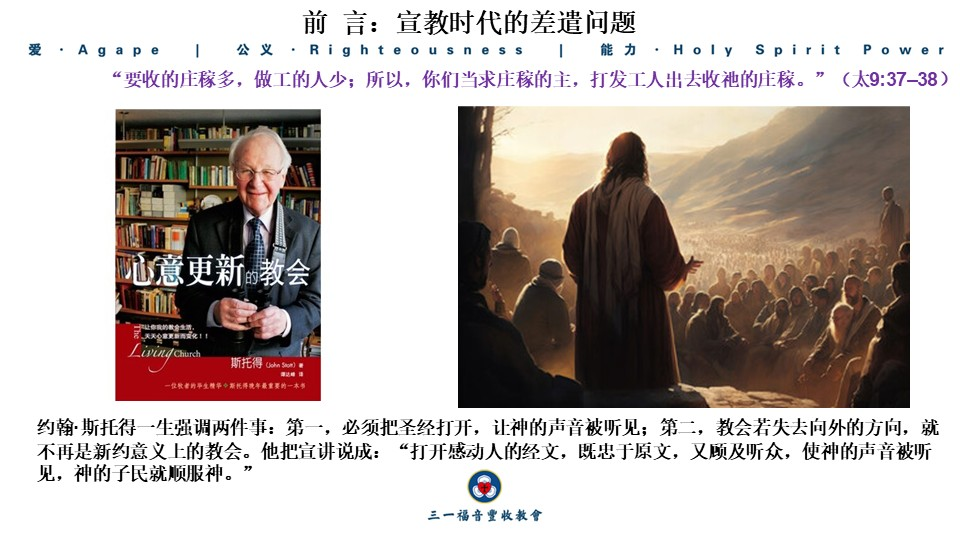
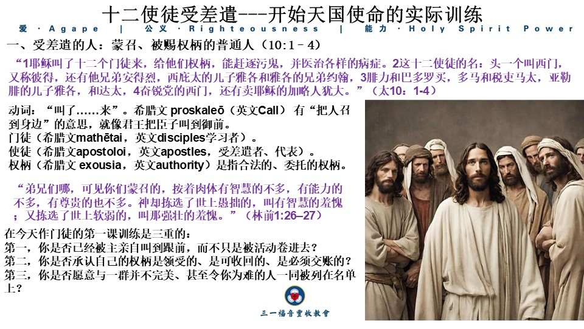
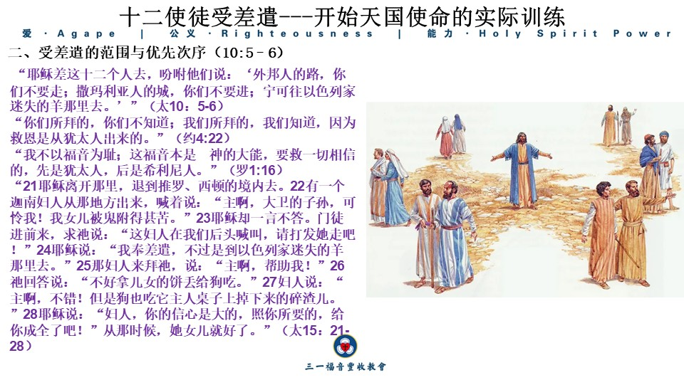
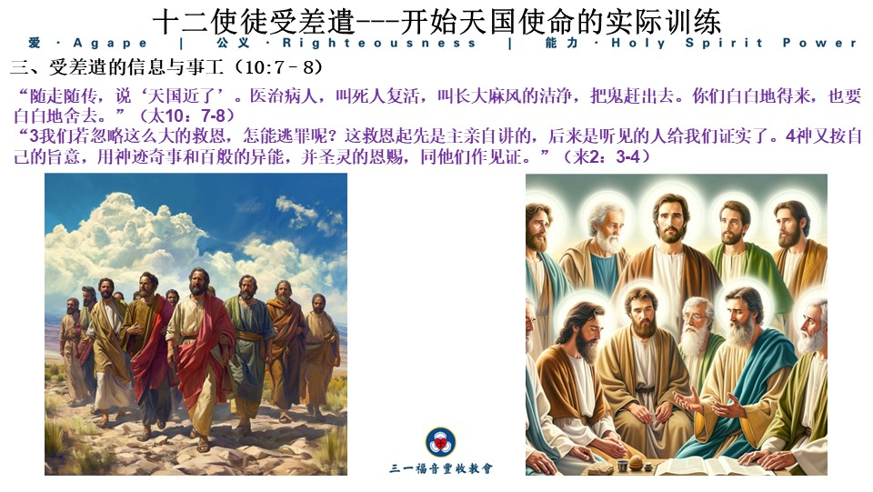
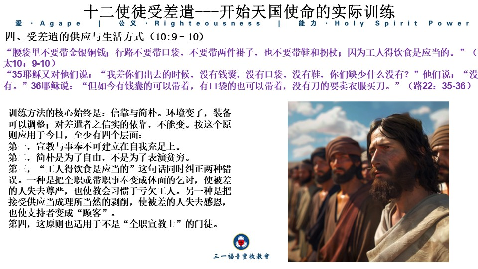
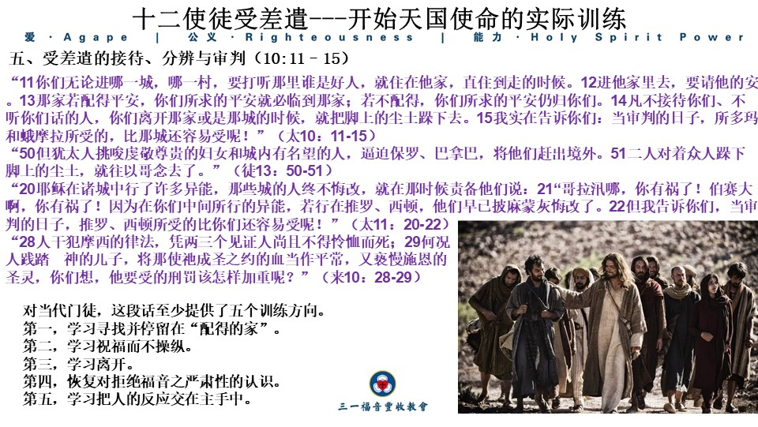
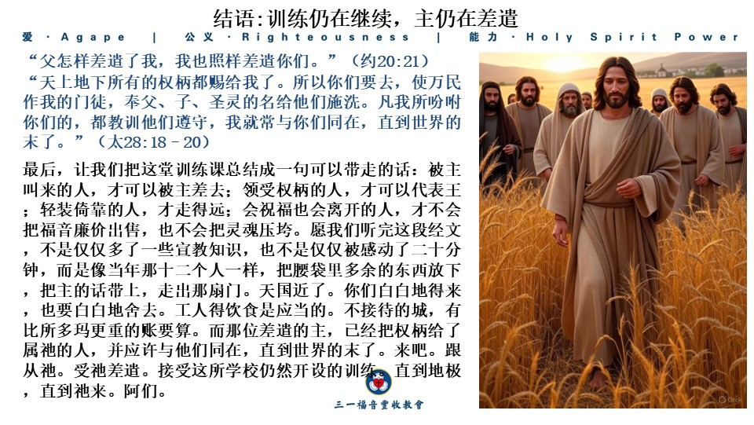

 2026年10月4日 

讲题：第一福音书马太信息系列三十： 十二使徒受差遣---开始天国使命的实际训练

毛志斌 Abraham Mao

经文：

 **“****1****耶稣叫了十二个门徒来，给他们权柄，能赶逐污鬼，并医治各样的病症。****2****这十二使徒的名：头一个叫西门，又称彼得，还有他兄弟安得烈，西庇太的儿子雅各和雅各的兄弟约翰，****3****腓力和巴多罗买，多马和税吏马太，亚勒腓的儿子雅各，和达太，****4****奋锐党的西门，还有卖耶稣的加略人犹大。****5****耶稣差这十二个人去，吩咐他们说：“外邦人的路，你们不要走；撒马利亚人的城，你们不要进；****6****宁可往以色列家迷失的羊那里去。****7****随走随传，说：‘天国近了！’****8****医治病人，叫死人复活，叫长大麻疯的洁净，把鬼赶出去。你们白白地得来，也要白白地舍去。****9****腰袋里不要带金银铜钱。****10****行路不要带口袋，不要带两件褂子，也不要带鞋和拐杖，因为工人得饮食是应当的。****11****你们无论进哪一城，哪一村，要打听那里谁是好人，就住在他家，直住到走的时候。****12****进他家里去，要请他的安。****13****那家若配得平安，你们所求的平安就必临到那家；若不配得，你们所求的平安仍归你们。****14****凡不接待你们、不听你们话的人，你们离开那家或是那城的时候，就把脚上的尘土跺下去。****15****我实在告诉你们：当审判的日子，所多玛和蛾摩拉所受的，比那城还容易受呢！”（太****10****：****1-15****）**

 

**前言：宣教时代的差遣问题**

弟兄姊妹，我们正生活在一个常说“宣教”的时代。很多教会日历里有宣教主日，年报里有宣教奉献，墙上贴着未得之民的地图，走廊里摆着短宣队的照片，讲台上常听到“大使命”。这些并不全是空话。更隐蔽的问题是：很多自称跟随耶稣的人，从未真正被差遣；很多已经“出去”的人，也没有按主的方法受过训练。我们有计划，却缺少权柄；有热心，却缺少顺服；有活动，却缺少被主耶稣基督亲自呼召、亲自授权、亲自打发的严肃感。宣教被机构化、节日化、专业化后，往往不再是每个门徒的生活方式，而成了少数人的职业，或多数人的旁观事业。

马太福音第十章正是为这种情景写的。它不是抽象的宣教学论文，也不是宣教大会的口号，而是天国之王亲自开的第一堂差遣训练课。要明白这课，必须先回到第九章的结尾。耶稣走遍各城各乡，在会堂里教训人，宣讲天国福音，医治各种病症。祂看到许多人，就怜悯他们，因为他们困苦流离，像没有牧人的羊。于是对门徒说：**“****要收的庄稼多，做工的人少；所以，你们当求庄稼的主，打发工人出去收祂的庄稼。****”****（太****9:37–38****）**下一章立刻记载：祂不只叫门徒祷告，祂亲自叫了十二个人来，给他们权柄，差他们出去。祷告与差遣在耶稣那里从不分开。庄稼的主听祷告的方式，常常是把祷告的人自己打发到田里去。 

约翰·斯托得一生强调两件事：第一，必须把圣经打开，让神的声音被听见；第二，教会若失去向外的方向，就不再是新约意义上的教会。他把宣讲说成：“打开感动人的经文，既忠于原文，又顾及听众，使神的声音被听见，神的子民就顺服神。”我们现在要做的，就是这件事。我们不把马太福音第十章当作钩子，挂上预先准备好的宣教概念；我们让这段经文本身掌权，决定我们该听什么、该做什么。这段经文的中心思想可以这样说：

耶稣差遣十二使徒，不是给他们一次孤立的任务，而是启动天国使命的实际训练。祂先赐权柄，然后限定范围、信息、方法和态度，让门徒学会倚靠、顺服、分辨、忠心。今天每一个被召为门徒的人，也同样被主差遣进入世界，接受同样的训练。换句话说，马太福音第十章不是博物馆里的使徒文物，而是基督门徒学校仍在使用的教材。我们按经文本身的脉络，分成五个部分来听。

**一、** **受差遣的人：蒙召、被赐权柄的普通人（****10:1–4****）**

**“****耶稣叫了十二个门徒来，给他们权柄，能赶逐污鬼，并医治各样的病症。****”**随后马太列出十二人的名字：西门彼得、安得烈、雅各、约翰、腓力、巴多罗买、多马、税吏马太、亚勒腓的儿子雅各、达太、奋锐党的西门，以及卖耶稣的加略人犹大。 

首先要注意动词：“叫了……来”。希腊文 **proskaleō****（英文****Call****）** 有“把人召到身边”的意思，就像君王把臣子叫到御前。差遣的起点不是人的自愿报名、也不是高分的性格测评，更不是一次感人的大会决志，而是主的呼召。他们原来是门徒（希腊文**mathētai**，英文disciples学习者），在第二节第一次被称为使徒（希腊文**apostoloi**，英文apostles，受差遣者、代表）。门徒和使徒的区别不在灵性等级的高低，而在关系的方向：门徒是被叫来跟随、学习的人；使徒是被打发去代表主人说话、行动的人。没有先“来”到主面前的人，就不能真正“去”。今天很多宣教的失败，并不是因为策略不够精细，而是因为人从未先在安静里被主亲自“叫来”。有人可以报名短宣、读完宣教学位、筹足经费，却从未在安静中听见主的呼召。那样的“去”，缺少使徒的本质：代表另一位。

其次，主“给他们权柄”。这里的权柄（希腊文 **exousia**，英文authority）是指合法的、委托的权柄，而不是 **dynamis** 那种内在的能量。他们能赶鬼、能医治各种病症，并不是因为他们比别人更有灵力，而是因为王把自己的代表权借给了他们。**马太福音第八、九章**已经用一连串事例展示王的主权：洁净大麻风、医治百夫长的仆人、平息风浪、把鬼赶进猪群、赦免罪、叫管会堂者的女儿复活。**第十章**进一步说明：这主权可以委托。这是差遣的根基。没有权柄，差遣只是把人推向战场；有了权柄，差遣就把王的同在带进村庄。使者的胆量不是来源于外向的性格，而是因为站在他背后的那一位，已经胜过他将要面对的污鬼与病症。 

当代的门徒必须重新学习这一地。我们常把“恩赐”当成自己的资产，把“事工”当成可以管理的事，把“影响力”当成可以经营的品牌形象。耶稣的思路恰恰相反：先有主人的呼召，才有受托的权柄；先有权柄，才有合法的行动。没有权柄的热情会变成操纵别人的良心；没有权柄的方法会变成推销的技巧；没有权柄的怜悯会变成另一种功德。真正的宣教训练，第一课不是学怎么开口，也不是学怎么做简报，而是学怎么站在主面前，承认：“我没有任何权柄，除非你给我。你若不差遣，我去也是徒然。”

再看这十二个人。他们中有渔夫，有税吏，有奋锐党人。性格、教育、政治立场全不一样。税吏为罗马收税，在同胞眼里几乎是卖国贼；奋锐党人以武力反抗罗马为理想。这两类人同在一份名单上，本身就是一个神迹。马太写自己的名字时，特意加上“税吏马太”。这不是自卑的展示，而是恩典的记号：被轻视的人也可以被差遣。名单的最后是加略人犹大。主知道他将要做什么，却仍把他列在最初的差遣里。这是圣经一贯的现实主义，也是斯托得常说的那种拒绝幻想的基督教。天国的使命从一开始就不是纯洁无瑕的英雄史诗，而是在破碎、混合、意见不合、甚至有叛徒的群体中进行的。今天如果有人因为教会不完美、同工不可靠、领袖有瑕疵、自己不够资格而拒绝接受差遣，他就在要求一种主从未设立的教会。主选用的材料，向来是有裂缝的器皿。 

十二这个数字本身就有神学的重量。它对应以色列的十二支派。神差遣这十二个人，成为新以色列的核心，也标记了神重建子民的起点。启示录里，新耶路撒冷的十二根基上写着十二使徒的名字（启21:14）。十二使徒的平凡，正好显示拣选是出自主，而不是出自人。保罗写道：**“弟兄们哪，可见你们蒙召的，按着肉体有智慧的不多，有能力的不多，有尊贵的也不多。神却拣选了世上愚拙的，叫有智慧的羞愧；又拣选了世上软弱的，叫那强壮的羞愧。”（林前****1:26****–****27****）**基督教使命的尊严不在使者的卓越，而在差遣者的身份。**我们是谁**并不重要，重要得是**谁差遣了我们**。因此，在今天作门徒的第一课训练是三重的：

第一，你是否已经被主亲自叫到跟前，而不只是被活动卷进去？

第二，你是否承认自己的权柄是领受的、是可收回的、是必须交账的？

第三，你是否愿意与一群并不完美、甚至令你为难的人一同被列在名单上？

若这三问的答案是否定的，后面一切关于策略、工场与方法的讨论，都还没有开始。主仍在呼召人。问题是：当祂呼召的时候，我们来不来？ 

**二、** **受差遣的范围与优先次序（****10:5–6****）**

**“耶稣差这十二个人去，吩咐他们说：‘外邦人的路，你们不要走；撒玛利亚人的城，你们不要进；宁可往以色列家迷失的羊那里去。’”** 这段话常使现代读者不安。我们习惯了马太福音二十八章“使万民作我的门徒”，几乎立刻觉得第十章的限制过时、狭窄，甚至带有民族偏见。若我们这样读，就会错过救赎历史的整体脉络，也会错过这堂训练课最要紧的一点：使者不可自己决定工场，工场由差遣者指定。耶稣当时的限制不是永远的排外原则，而是阶段性的安排。救恩从犹太人出来（约4:22）。神与亚伯拉罕立约，要万国因他的后裔得福，但实现这约的顺序是**“****先是犹太人，后是希腊人****”****（罗****1:16****）。**弥赛亚必须先向自己的百姓显明，好让应许先落在先领受应许的人身上。十二使徒代表十二支派，第一步是向“以色列家失丢的羊”宣告：你们的牧者、你们的王已经来到。以西结书三十四章曾指责以色列的牧人只顾自己、不顾羊群，并应许神自己要寻找失丢的羊。耶稣正是在实现那应许。撒玛利亚人和外邦人并没有被永久排除。稍后，同一位主会走过撒玛利亚，在井旁的妇人面前显明自己是基督（约4章）；同一位主会称赞罗马百夫长的信心在以色列中少见（太8:10）；同一位主会让迦南妇人的信心突破“先给家里孩子”的顺序（太15:21–28）；最终，同一位主会站在加利利山上说：**“****天上地下所有的权柄都赐给我了。所以你们要去，使万民作我的门徒。****”****（太****28:18–19****）**从第十章到第二十八章，后面的章节不是在纠正前面的错误，而是同一计划分阶段完成。先向以色列，是为了最终临到万邦。

**“你们所拜的，你们不知道；我们所拜的，我们知道，因为救恩是从犹太人出来的。”（约****4:22****）**

**“****21****耶稣离开那里，退到推罗、西顿的境内去。****22****有一个迦南妇人从那地方出来，喊着说：“主啊，大卫的子孙，可怜我！我女儿被鬼附得甚苦。”****23****耶稣却一言不答。门徒进前来，求祂说：“这妇人在我们后头喊叫，请打发她走吧！”****24****耶稣说：“我奉差遣，不过是到以色列家迷失的羊那里去。”****25****那妇人来拜祂，说：“主啊，帮助我！”****26****祂回答说：“不好拿儿女的饼丢给狗吃。”****27****妇人说：“主啊，不错！但是狗也吃它主人桌子上掉下来的碎渣儿。”****28****耶稣说：“妇人，你的信心是大的，照你所要的，给你成全了吧！”从那时候，她女儿就好了。”（太****15****：****21-28****）**

对当时的门徒来说，这是一种很具体的训练：学会按主的时间表行事，而不是凭自己的热情或自以为对的感觉挑选工场。加利利有许多希腊化的城镇，去那边似乎更开放、更有文化，也更像后人说的“跨文化”。主说不要去。不是那些人不需要福音，而是你们现在的功课是先忠于指定的范围。很多宣教的失误，起于人爱自己想象的丰盛田地，胜过爱主此刻的吩咐。有人向往远方，却对家里的人闭口；有人热衷统计未得之民，却不敢向同事清楚传讲基督。不是远方不重要，而是不肯在指定的范围里学习顺服的人，到了远方也只会随己意而行。

“迷失的羊”这句话必须听进去。以色列被先选，不是因为比别的更好，而是因为他们迷失。差遣总是指向迷失的人，而不是朝向已经饱和的敬虔圈子。今天的教会如果只在信徒里转来转去，互相服事，互相欣赏，却对门口、邻里、族群里的迷失者无动于衷，就违背了这最初的差遣逻辑。斯托得曾说，教会若失去向外的方向，就不再是新约意义上的教会。宣教不是教会的一项节目，不是年历上的一个主日，而是教会之所以为教会的本质。一间只聚不散、只会收聚不差遣的群体，无论多么热闹，都更像俱乐部，而不像使徒的团体。

对今天的门徒来说，地理上的“外邦人的路不要走”已经随着复活主的大使命而解除。但“优先次序”与“指定范围”仍然在。神把每一个门徒安放在具体的关系网、城市、语言、职业和时代里。有人被召去往远方的未得之民，有人被召在自己的家、公司、校园、邻里作见证。有人被召在逼迫的地方悄悄作盐，有人被召在开放之地公开传扬。训练的关键在于：你是否先问“主现在差我往哪里”，而不是先问“哪里比较荣耀、比较符合我喜欢讲述的负担故事、比较容易获得支持者的掌声”。

还有一层当说清楚。第十章的限制提醒我们尊重救赎历史，也提醒我们不可把任何阶段性的安排当成永远的。有些传统把“只传以色列”读成某种持续的排外神学，这是误用。另有些人反过来，把二十八章读成可以轻看身边迷失的羊，只要远方的数字足够壮观。这两种读法都没有让经文作主。正确的读法是：先看主当时怎样指定，再看主如今凭完全的权柄怎样扩展；然后在我们这世代里，问同一位主：“你现在把我放在哪一块田里？”所以第二课的训练是：接受主所指定的范围，尊重救赎历史的次序，同时活在已经颁布的万邦使命里。不擅自扩大，也不擅自缩小。不把暂时的安排当成永久的墙，也不要把最终的视野变成当下的借口，好逃避身边那一只迷失的羊。

**三、受差遣的信息与事工（****10:7–8****）**

**“随走随传，说‘天国近了’。医治病人，叫死人复活，叫长大麻风的洁净，把鬼赶出去。你们白白地得来，也要白白地舍去。”**信息只有一句：“天国近了。”这和施洗约翰的宣告（太3:2）以及耶稣在加利利的宣告（太4:17）完全一样。他们不是去传播一种新的宗教体验，不是去推销一套改善家庭与职场的技巧，也不是去宣布一种可以与其他世界观和平共存的人生哲学。他们是在宣告：神的统治已经临近。王来了。人必须悔改，信靠福音。信息的简洁本身就是训练。门徒极易把福音讲得复杂，讲成自己的见解体系、自己的见证高潮、自己对时局的评论。主把他们限制在一句已经说过、必须再说的话上：把王的宣告原封不动地传出去。使者不是信息的作者，只是信息的送信人。送信人若改动了信件，他就不再是使者，而成了另一位作者。 

信息后面必须跟行动：叫死人复活、叫长大麻风的洁净、把鬼赶出去。这些不是附加的慈善项目，而是国度临在的记号。第八章和第九章里，耶稣亲自做的事，现在要靠差遣的使者继续做。话语解释作为，作为印证话语。神的国不是空谈，也不是只有社会服务；它是王的权柄进入被罪、疾病、污鬼与死亡捆绑的世界。麻风代表隔绝和不洁，污鬼代表黑暗的奴役，疾病和死亡是堕落世界最明显的记号。使者带着王的权柄进入这些领域，说明王已经开始收回被仇敌占领的土地。必须立刻加上那句限制性的、保护性的话：**“你们白白地得来，也要白白地舍去。”**这是整段最锋利的句子之一。王的权柄是恩典，事工也是恩典。事工不能把医治变成收费项目，不能把赶鬼变成表演，不能把死人复活变成募款广告。第一世纪有巡回术士用法术换取金钱与名声；主把门徒与那种宗教市场彻底切开。今日的对应物并不难找：把恩赐商品化，把见证产业化，把“能力”包装成可以定价的特会、课程或个人品牌。主说：白白得来的，必须白白舍去。否则，使者就不再代表那位“无条件施恩的王”，而代表另一个主人——市场、名声，或自己的事工帝国。 

在实际操作时，我们要保持两方面的平衡。一方面，不能把第八节的神迹清单直接当成今天每位信徒、每次短宣必须照搬的任务单。十二使徒的职分有独特性，早期教会的神迹记号是为福音在历史上奠基（来2:3–4）。把所有经文一概“直接模仿”，往往不是高举圣经，而是忽略圣经自己的救赎历史结构。另一面，也不可把这段经文精神化到只剩下“传道理”，仿佛肉体的痛苦、被压制的心灵、被排斥的病人与主无关。耶稣的使命从来是整全的：宣讲与怜悯、真理与能力、悔改的呼召与对受苦者的触摸。今天门徒的训练，就是学习在自己的处境中，用话语宣告天国，用行动显明天国的怜悯，却不把任何一面变成可以出售的商品，也不把任何一面从福音中剔除。

 **“****3****我们若忽略这么大的救恩，怎能逃罪呢？这救恩起先是主亲自讲的，后来是听见的人给我们证实了。****4****神又按自己的旨意，用神迹奇事和百般的异能，并圣灵的恩赐，同他们作见证。”（来****2****：****3-4****）**

“随走随传”也应该成为我们的提醒。我们不是先安营、先做好后勤、先搞品牌识别再开口，而是边走边说。现在的宣教训练隐藏着一个危机：把人留在预备阶段太久，课程接着课程，评估接着评估，导致“走”本身被无限拖延。预备是必要的，主自己也花了许多日子教导十二使徒。但第十章显示，教导和差遣几乎是同时进行的。权柄已经交给，话语已经交付，现在就走。在走的过程中学习，传的过程中被纠正，在失败和接待里认识自己的不足和主的信实。这不是轻率，而是相信差遣者会在路上继续作老师。 

还有一句话要在今天的讲台上说。许多地方的“福音”已经不太像“天国近了”。它更像心理安慰、成功的应许、文化立场或道德的重整。这些可能触及真实的需要，却不是第十章的核心信息。天国近了，意味着有一位王，有一种统治，有一种对全人的要求，也有一种对罪人的怜悯。没有王的福音不是福音；没有紧迫感的“近了”也不是这段经文的意思。第三课因此是：把福音说清楚，把恩典活出来，把能力用在服事人而不是提升自己，并且开始走，而不是永远只在装备自己。

**四、受差遣的供应与生活方式（****10:9–10****）**

**“腰袋里不要带金银铜钱；行路不要带口袋，不要带两件褂子，也不要带鞋和拐杖；因为工人得饮食是应当的。”**这段话最容易被两种相反的方式误用。第一种把它变成所有时代、所有工场都必须字面遵守的清贫法规，于是有人用它指责所有有支持系统、有预算、有保险的宣教。第二种把它当作已经过时的第一世纪习俗，于是完全失去其中的属灵纪律。两种读法都没有耐心让经文先作它当时要作的事，再作它今日仍要作的事。按原意，这是一次短期、在熟悉文化区内的巡回。他们走在自己同胞中间。犹太社会有接待客旅、尤其是接待神的使者与拉比的传统。主禁止他们带备用的金钱、行囊、额外衣服、鞋和拐杖，是要他们当场学习两件事。第一，使命的供应在于差遣者，不在于自己的储备。第二，接受当地的接待不是羞耻，因为“工人得饮食是应当的”。后一句话同时保护使者的尊严，也保护接待者的参与。若使者拒绝一切供应，就剥夺了当地人与福音同工的机会，把恩典变成单向的表演；若使者自己准备得过于周全，就不必再信，也不必再进入那种互相倚靠的关系。信靠与团契在这里是紧紧相连的。 

主耶稣后来在路加福音二十二章三十六节，对同一批门徒说了似乎相反的话：**“但如今有钱囊的可以带着，有口袋的也可以带着，没有刀的要卖衣服买刀。”（路****22****：****36****）**祂先问：**“我差你们出去的时候，没有钱囊，没有口袋，没有鞋，你们缺少什么没有？”他们说：“没有。”（路****22****：****35****）**可见第十章的禁令不是一切处境的永久法规，而是这一次训练的教学法。教学法的核心始终是：信靠与简朴。环境变了，装备可以调整；对差遣者之信实的依靠，不能变。按这个原则应用于今日，至少有四个层面。

第一，宣教与事奉不可建立在自我充足上。现代宣教深深被专业主义与项目管理塑造：预算表、风险评估、保险、退路、品牌、支持网络。这些可以是智慧的工具，也可以成为不信的遮掩。问题不在于计划本身——主自己也差他们按城按村有次序地走——而在于计划是否取代了“工人的饮食是主负责”的信心。十九世纪戴德生坚持不向人募款、只向神求，这不是每个人必须照搬的规条，却是对这段经文精神的强烈回应：若神差遣，神必供应。今日的门徒至少应当诚实地问：我的安全感主要是放在账户、机构与人脉上，还是放在差遣我的主身上？若主明天收回这些可见的支持，我是否还认为自己仍被差遣？

第二，简朴是为了自由，不是为了表演贫穷。两件褂子、多余的鞋与拐杖，代表可以减轻却不愿减轻的负担。如果使者被自己的生活水平、消费习惯、面子、电子装备与舒适标准绑架，就进不去别人的家，也不能自然地和贫穷人或受逼迫的信徒同住。当代许多见证的障碍，不是信息不够清楚，而是使者的生活方式与所传的十字架福音互相矛盾。人听见我们讲舍己，看见的却是我们为细节斤斤计较的舒适。简朴不是律法，而是爱的策略：为了别人的缘故，把自己活得更简单一点。

第三，“工人得饮食是应当的”这句话同时纠正两种错误。一种是把全职或带职事奉变成体面的乞讨，使被差的人失去尊严，也使教会习惯于亏欠工人。另一种是把接受供应当成理所当然的剥削，使被差的人失去感恩，也使支持者变成“顾客”。保罗在哥林多前书第九章详细说明：主怎样命定，靠福音养生是应当的；他自己却多次自愿放弃这权利，只为了不拦阻福音。训练有素的门徒，既知道自己配得供应，又不把供应当成谈判的筹码。教会若一边差遣人，一边让被差的人在经济上孤立无援、家庭陷入困窘，就是违背主的话。被差的人若把支持者当作需要维护的金主，而不是同作神工的肢体，也是违背主的话。

第四，这原则也适用于不是“全职宣教士”的门徒。每一个在职场、校园、邻里被差的人，都需要学习轻装。轻装在这里指的是：不把事业成就、子女出路、社会评价当成不可放下的第二件褂子，以致无法为基督的缘故调整步伐。许多人不是没有负担，而是口袋太重，走不动。第四课训练是学习轻装出发，信靠供应，保持简朴，并在给予与接受中活出福音的互惠。这不是浪漫的清贫主义，也不是反智的反计划，而是使命的纪律：让世界看见，我们的主真的养活祂的工人。

五、**受差遣的接待、分辨与审判（****10:11–15****）** 

**“你们无论进哪一城、哪一村，要打听那里谁是好人，就住在他家，直住到走的时候。进他家里去，要请他的安。那家若配得平安，你们所求的平安就必临到那家；若不配得，你们所求的平安仍归你们。凡不接待你们、不听你们话的人，你们离开那家或是那城的时候，就把脚上的尘土跺下去。我实在告诉你们，当审判的日子，所多玛和蛾摩拉所受的，比那城还容易受呢！”**最后这一段把差遣从“如何走”推进到“如何面对人的回应”。如果宣教训练只教人出发，却不教人如何进门、如何停留、如何祝福、如何离开，就只完成了一半。

“打听谁是好人”（或译“配得的人”、“合适的人”）不是势利地寻找有钱有势、能提供高级住宿的东道主。它是在寻找那愿意接待神使者的人，也就是后来宣教学常说的“平安之子”。主不要他们在城中游荡，今晚这家明晚那家，好像流动摊贩。稳定的居住，使信息有时间被听见，让生命有时间被观察。福音需要一个家，而不只需要街头。进门之后，“请他的安”不是社交套话。犹太人口中的“平安”（shalom）本是完整、和睦、兴盛的祝福。在使者口中，这平安成为国度祝福的实质传递。若那家配得——意思是以开放的心接待使者及其所传的道——平安就留下；若不配，平安归回使者。福音的祝福不是可以强行安装的软件，它寻找可以安息的地方。主把使者口中的祝福看得极重：它真的能临到，也真的能归回。我们不能把祷告变成客套。被拒绝的时候，他们要把脚上的尘土跺掉。第一世纪的犹太人离开外邦地区时，常跺去外邦的尘土，表示与不洁隔绝，免得把外邦的污秽带回圣地。如今这动作对着以色列自己的城邑发出，含义极为严重：拒绝弥赛亚使者的地方，在神眼中如同外邦，如同不洁之地。这不是个人赌气，不是“你们不配得我这样的人”，而是先知性的记号：我们把你们的拒绝留下，作为将来的见证；我们不把尘土带走，也不把怨恨带走。保罗后来在彼西底的安提阿，当被犹太人抗拒并毁谤时，就和巴拿巴一起跺下脚上的尘土（徒13:51）。跺尘土是一种爱的严肃形式：它拒绝假装什么都没有发生，也拒绝让使者的灵魂被苦毒污染。

**“****50****但犹太人挑唆虔敬尊贵的妇女和城内有名望的人，逼迫保罗、巴拿巴，将他们赶出境外。****51****二人对着众人跺下脚上的尘土，就往以哥念去了。”（徒****13****：****50-51****）**

然后是那句令人战兢的话：**“当审判的日子，所多玛和蛾摩拉所受的，比那城还容易受呢！”**所多玛的罪恶在圣经中是毁灭的典范，它的罪与拒绝、凌辱神的使者直接相关（创19）。主说，那些看见国度临近、听见王的宣告、却把使者拒之门外的城，罪比所多玛更重。不是因为他们的道德丑闻更大，而是因为他们见到的光更大。光越大，拒绝的责任越重。这是整本圣经一贯的原则。马太福音十一章，主对哥拉汛、伯赛大、迦百农说了同样的话：如果在所多玛行的异能还能留到今天，那么审判的日子，所多玛所受的比你们还容易受（太11:20 24）。希伯来书也提出同样的问：干犯摩西律法的人尚且不得怜恤而死，何况那践踏神儿子的人（来10:28‑29）？

**“****20****耶稣在诸城中行了许多异能，那些城的人终不悔改，就在那时候责备他们说：****21****“哥拉汛哪，你有祸了！伯赛大啊，你有祸了！因为在你们中间所行的异能，若行在推罗、西顿，他们早已披麻蒙灰悔改了。****22****但我告诉你们，当审判的日子，推罗、西顿所受的比你们还容易受呢！”（太****11****：****20-22****）**

**“****28****人干犯摩西的律法，凭两三个见证人尚且不得怜恤而死；****29****何况人践踏　神的儿子，将那使祂成圣之约的血当作平常，又亵慢施恩的圣灵，你们想，他要受的刑罚该怎样加重呢？”（来****10****：****28-29****）**

我们不能把这段话当作发泄怒气。它是爱里的警告。正因为拒绝不是小事，今天的邀请才是真正的恩典。对当代门徒，这段话至少提供了五个训练方向。 

第一，学习寻找并停留在“配得的家”。宣教与见证不是随便向所有人推销，也不是靠接触人数自我安慰。圣灵常先为一些人预备。急于出成绩的人，会把时间耗在一扇扇关闭的门上，却忽略那一扇已经微开启的门。无论在家庭、校园、职场、移民群体与村落中，都有这样的人。受过训练的门徒会问路，会观察，会停留，而不是只撒种子却从不浇灌。

第二，学习祝福而不操纵。平安可以临到，也可以归回。我们不能用心理技巧、关系压力、物质帮助或群体氛围去换取“决志”。使者的责任是忠实传递并真心祝福；人的心门由神打开人。操纵可以制造数字，造不出门徒。

第三，学习离开。有一种虚假的坚持，把不肯离开当成爱心，把反复纠缠当成忠心。主却命令：不接待、不听的，就离开，并作记号。离开不是放弃对人的爱，而是拒绝把福音变成可以无限打折、无限纠缠的商品，也是把审判权交还神。在冷漠、嘲讽或逼迫的处境中，这命令保护使者免于苦毒，也保护福音免于被羞辱。当然，离开的时机需要智慧，需要与其他经文（如长久忍耐、恒切祷告）一同读。但第十章至少禁止一种态度：好像人的拒绝无关紧要，我们可以若无其事地永远待下去。

第四，恢复对拒绝福音之严肃性的认识。现代文化喜欢把信仰说成“一种选择”、“一种私人生活方式”、“一种文化身份”。主却把拒绝说成比所多玛更危险的事。若我们传福音时毫无紧迫感，从不提到责任与审判，只强调福音如何使人生更美好，我们就不是在传耶稣当时所传的同样的信息。斯托得从不把福音缩减为恐吓，他深知十字架首先是恩典的彰显；但他同样拒绝把十字架的冒犯抹掉。爱与真实必须同行：因为审判是真的，所以此刻的呼召才是怜悯。

第五，学习把人的反应交在主手中。平安归回使者，尘土跺在门外，审判留给那日。这意味着使者不必为每一次拒绝自我撕裂。我们去传福音，问候平安，决定留下或离开，结果交在神手里。这不是冷漠，而是谦卑。许多受差遣的人在心理上被压垮，不是因为工作太重，而是因为把别人的永生全背在自己肩上。**第十章**把这担子放回原处：交在王的肩上。

**结语：训练仍在继续，主仍在差遣**

 我们回头看这十五节。主召人来，给人权柄，规定范围，交付一句简洁的信息，吩咐他们行出国度的怜悯，命令他们轻装、接受供应、寻找配得的家、请安、停留、祝福或收回祝福，并在拒绝之处跺去尘土，把更重的审判交托给那日。这一切发生在十字架与复活之前，发生在五旬节圣灵降临之前，发生在马太福音二十八章大使命颁布之前。它是开始，不是完成。它是训练学校的第一学期，不是毕业礼。

第一学期的功课没有一门是过时的。我们仍然需要被主亲自召唤，而不是被气氛、羞耻或英雄叙事推动；我们仍然需要领受权柄，而不是依靠人格魅力、修辞能力或机构品牌；我们仍然需要顺服指定的范围，而不是只追随自己喜欢讲的荣耀地图；我们仍然需要把“天国近了”说清楚，并把白白得来的恩典白白舍去；我们仍然需要轻装、信靠、简朴，承认工人的饮食在于主，也承认工人配得饮食；我们仍然需要寻找平安之子，祝福而不强求，离开而不怀恨，并记得拒绝福音不是可以由我们自行淡化的小事。 

十字架与复活之后，同一位主把训练带进了新的阶段。祂对门徒说：**“****父怎样差遣了我，我也照样差遣你们。****”****（约****20:21****）**这差遣的方式就是道成肉身：进入世界，住在人中间，满有恩典与真理。祂又说：**“****天上地下所有的权柄都赐给我了。所以你们要去，使万民作我的门徒，奉父、子、圣灵的名给他们施洗。凡我所吩咐你们的，都教训他们遵守，我就常与你们同在，直到世界的末了。****”****（太****28:18–20****）**

权柄更大了——不再是局部委托，而是天上地下所有的权柄。范围更广了——不再限于以色列家迷失的羊，而是万民。同在的应许更明确了——直到世界的末了。训练没有取消，只是升级。十二使徒后来把福音从耶路撒冷带到地极，其中多数以殉道结束道路。他们不是一开始就那样刚强。他们正是从马太福音第十章那些具体、琐碎、甚至看起来“不属灵”的指示里被训练出来的：不要带额外的褂子，先打听谁是好人，听不进去就跺尘土。伟大的使命，是从微小的顺服慢慢长成的。 

当代的门徒啊，主今日仍在呼召人。祂呼召的不一定是最有口才的、最有学历的、最没有家庭牵挂的、最符合宣教海报形象的。主呼召那些愿意来的人，给他们权柄，把他们放进真实的道路里。对一些人，这道路是对邻舍开口的第一步；对一些人，这条道路是参加一间教会有纪律的差遣与训练；对一些人，这条道路是走向另一个城市、另一种语言、另一个民族；对一些人，这条道路是在压力与监视之下学习轻装、依靠接待、辨别接待家庭、并在必须离开时把尘土跺下去而不把仇恨带走。形式会变，主的方法不会变：先来，后去；先领受，后舍去；先顺服范围，后看见扩展；先忠于信息，后看见果效；先作门徒，后作使者。我们也当对教会说一句话。一间教会若只鼓励人“关心宣教”，却从不按主的方法训练人、差遣人、供应人、接纳被差回来的人，也不教导如何面对拒绝与审判的严肃，它就还没有真正进入马太福音第十章。庄稼的主听祷告的方式，往往是把祷告的群体自己变成被打发的工人。求主打发工人，同时要预备自己被打发。庄稼仍然多，工人仍然少。困苦流离、如同羊没有牧人的人群，并未减少；在我们的城市里，在远离我们的民族中，在已经听过多次却仍关闭的心里，都是如此。主仍然要我们求祂打发工人。但求完以后，不要惊讶：祂可能先打发你。

最后，让我们把这堂训练课总结成一句可以带走的话：**被主叫来的人，才可以被主差去；领受权柄的人，才可以代表王；轻装倚靠的人，才走得远；会祝福也会离开的人，才不会把福音廉价出售，也不会把灵魂压垮。**愿我们听完这段经文，不是仅仅多了一些宣教知识，也不是仅仅被感动了二十分钟，而是像当年那十二个人一样，把腰袋里多余的东西放下，把主的话带上，走出那扇门。天国近了。你们白白地得来，也要白白地舍去。工人得饮食是应当的。不接待的城，有比所多玛更重的账要算。而那位差遣的主，已经把权柄给了属祂的人，并应许与他们同在，直到世界的末了。来吧。跟从祂。受祂差遣。接受这所学校仍然开设的训练。直到地极，直到祂来。阿们。

 
